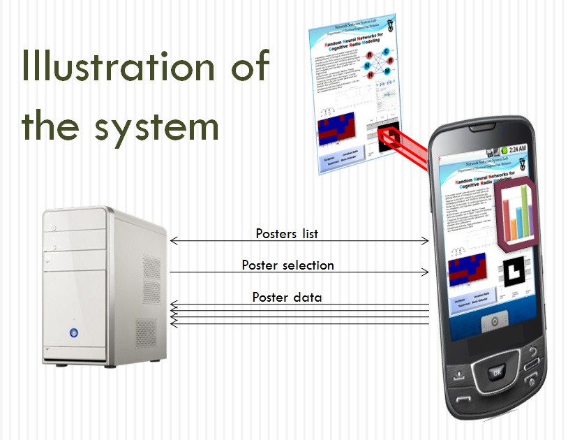

# Augmented Reality Posters

  

Recovered Android code for selecting posters and downloading content for a QCAR-based augmented-reality application.

Students: Michael Weiss, Myr Hagay.

Supervision: Aaron Wetzler.

## Available source

The historical application used a printed poster as an augmented-reality marker and displayed associated virtual content. The recovered files implement poster selection, content download and supporting data/UI classes; the marker-tracking implementation and its SDK integration are not included.

[`source/`](source/) preserves ten unchanged text files from the historical handoff: six Java classes, two native headers defining picture vertices, texture coordinates and triangle indices, the Android manifest and platform properties. The classes are `AboutDialog`, `ContentGetter`, `MainScreen`, `PosterData`, `PosterOptionsActivity` and `PostersListActivity`. `ContentGetter` downloads an index and images using Apache HttpClient; its index parser reads title, names and website lines into poster records. It expects resource strings and server content that are absent from this subset.

## Historical requirements

The project used Android/Eclipse, Java, native C++/JNI, QCAR and OpenGL. The archived report describes development on Windows Vista/7 with Eclipse/ADT and Cygwin/NDK, targeting an Asus Transformer TF101 running Android 3.1. Its native-build instructions refer to the complete original project, not this subset. `default.properties` targets API 11; the manifest sets minimum API 8. The launcher is `com.qualcomm.QCARSamples.ImageTargets.MainScreen`. The package name is retained from the historical integration; it does not identify the student additions as Qualcomm-authored.

The final archive included Qualcomm sample files explicitly marked Confidential and Proprietary. Those Java/native sample files, native makefiles, SDK resources/libraries and APKs are excluded. UI assets, poster data, Eclipse workspace/user state and unreviewed reports/presentations are also omitted. The remaining files reference missing sample classes and resources and cannot build standalone. Do not restore excluded sample or SDK material without separately establishing redistribution rights. Exact QCAR, NDK and Eclipse versions and a verified build command are unavailable.

## Validation and limitations

A private recovery manifest (not published) records hash checks for all ten included files. The documentation review inspected the download/index parser, data classes, launcher and platform configuration. No application build, content download or tracking run was performed; the historical server was not validated. The figure above is an archived system illustration, not a screenshot or a newly measured result.

## Links

- [Project entry on Aaron Wetzler's website](https://twerdster.github.io/#augmented-reality-posters)

## Attribution and reuse

The historical report uses the name variants Miki Weiss and Hagay Myr; website credits above are retained. No blanket license has been added. The included files and omitted third-party dependencies retain their original ownership and terms. Original authors can open an issue to contribute updates or request corrections or removal of their material.

Figure provenance: `assets/project-preview.jpg` is the original student-project system illustration from the archived project page on Aaron Wetzler's website, copied without modification.

