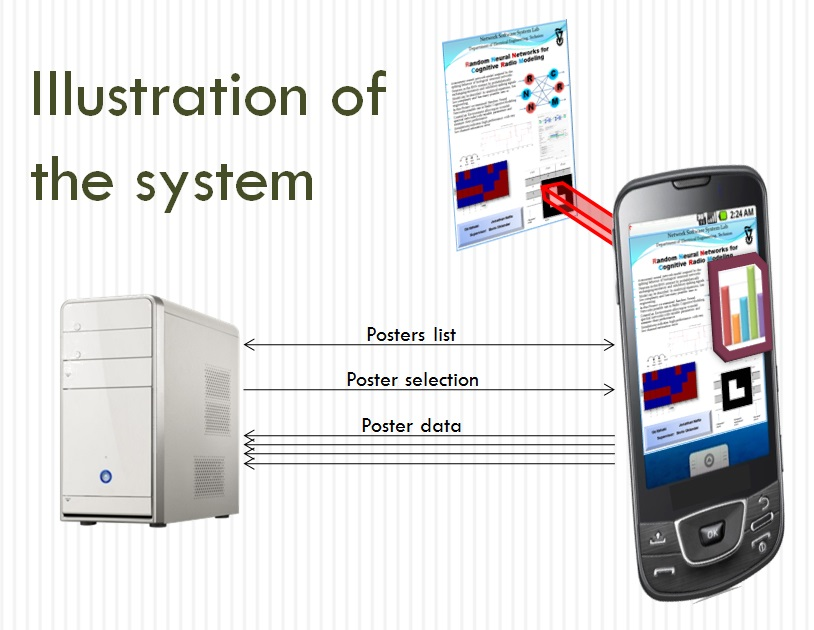

# Augmented Reality Posters

<p align="center">
  
</p>

*Original illustration of the intended system, unchanged.*

This Android project linked printed posters to downloadable digital content, intended for display in an augmented-reality view built on the QCAR SDK.

Students: Michael Weiss, Myr Hagay. Supervision: Aaron Wetzler.


## Original

Ten Java, JNI-header and configuration files survive unchanged; they cover poster selection and content download. The SDK integration and required resources are missing, so the project cannot be built on its own. Proprietary QCAR sample and SDK files are not included in this repository. The [recovery notes](docs/RECOVERY.md) record historical requirements and attribution.

## Updated

[**Run the browser demo**](https://twerdster.github.io/augmented-reality-posters/)

A separate browser demo, written in November 2026, uses a local catalog of three fictional posters. Choose a poster, toggle its diagram and annotation layers, drag or rotate the overlay and export your selection. Placement is manual: the demo does not recognize posters, use a camera or run QCAR. The recovered original files are unchanged.

### Run locally

```sh
python3 -m http.server 8000 --directory docs
```

Then open http://localhost:8000. No build step or external service is required.

### Checks and licensing

Browser-check results, implementation notes and limits are in [updated/README.md](updated/README.md). These checks apply only to the new demo; they do not validate the historical application or any device. The [MIT license](docs/DEMO-LICENSE.txt) covers only the new demo; original materials keep their existing attribution and terms.
